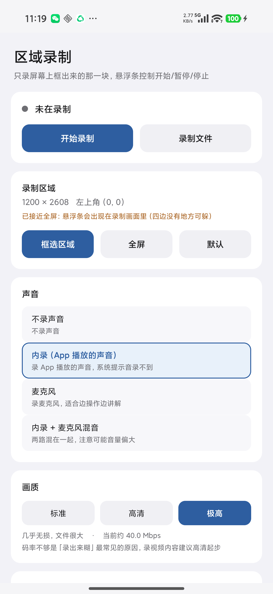
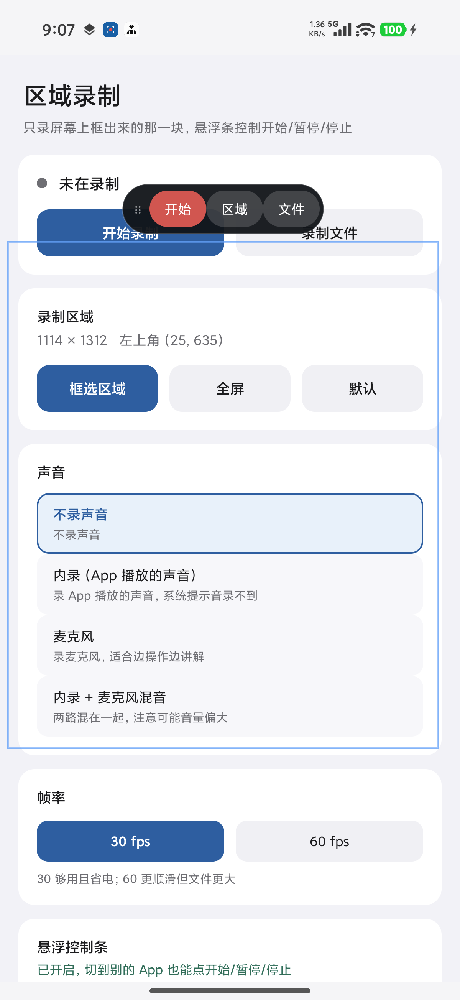
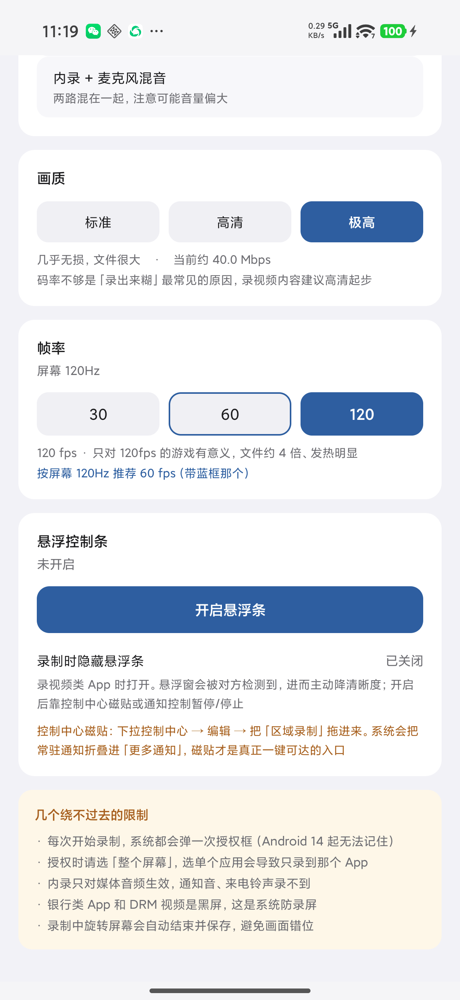
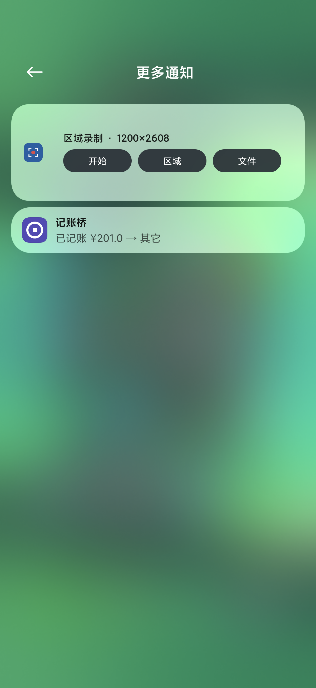
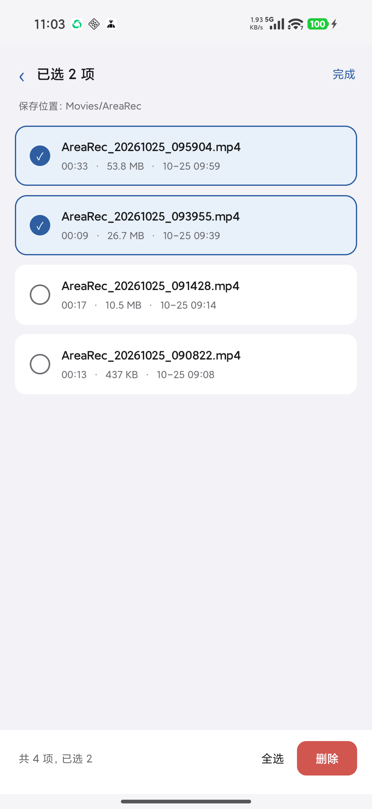
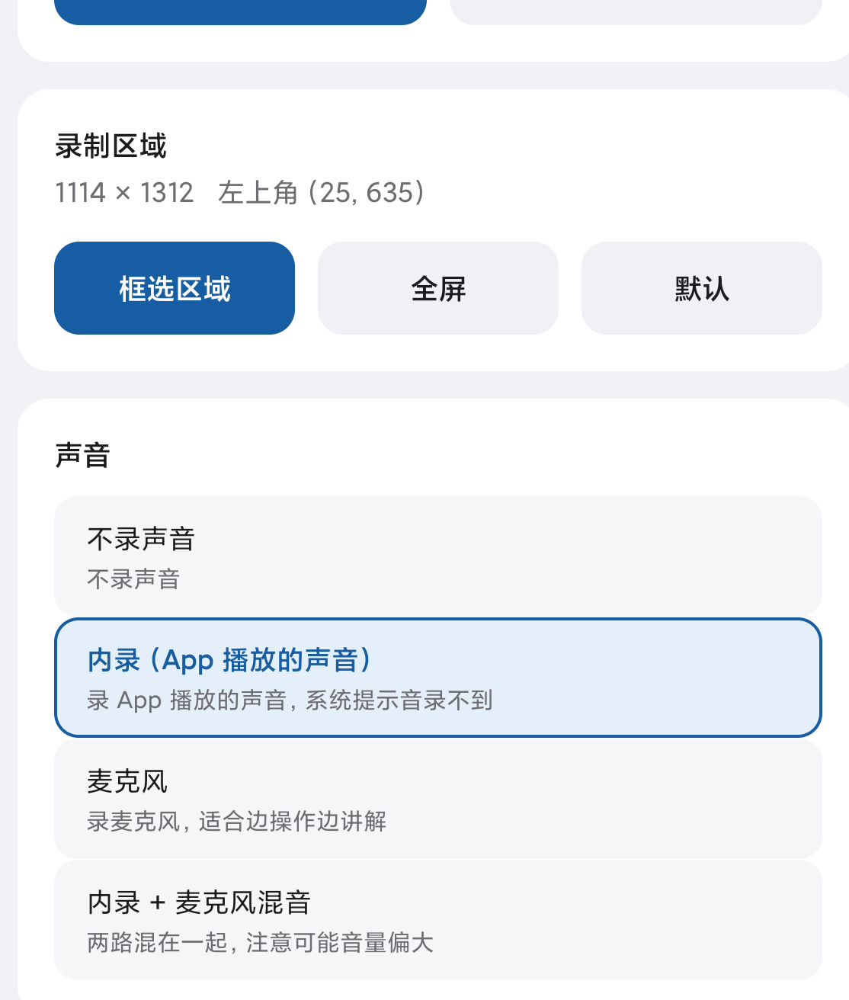

# Android-ScreenAreaRec

**只录屏幕上框出来的那一块。** 一个不需要 root 的 Android 区域录屏 App。

用常驻悬浮条控制开始 / 暂停 / 停止 / 打开录制文件，声音可选内录、麦克风或两者混音，
画质和帧率按屏幕能力自动推荐。

> Screen area recorder for Android. Records only the region you select, controlled by a
> floating bar. Pure system APIs, no root, no third-party dependencies.

- 最低支持 **Android 10（API 29）**
- **零第三方依赖**，全部使用系统 API（MediaProjection / EGL / MediaCodec / MediaMuxer）
- 约 3000 行 Kotlin

---

## 截图

| 主界面 | 框选区域 |
|---|---|
|  |  |

| 画质 / 帧率 / 悬浮条设置 | 通知栏控制面板 |
|---|---|
|  |  |

| 文件管理（多选批量删除） | 录制成片 |
|---|---|
|  |  |

**关于最后那张成片**：视频尺寸 1114 × 1312，正好是框选的那一块。画面里 App 自己显示着
「1114 × 1312 @ (25, 635)」—— 文字没有变形、没有缩放，说明裁剪是逐像素精确的。

---

## 功能

- **区域录制** —— 全屏遮罩上拖拽选框，8 个手柄可调，也能在任意位置重新拉一个框
- **悬浮控制条** —— 常驻屏幕，可拖，**自动吸附到录制区域之外**（避免自己被录进画面）
- **三路音频** —— 内录（App 播放的声音）/ 麦克风 / 两者混音
- **画质与帧率** —— 三档画质（标准 / 高清 / 极高），帧率按屏幕刷新率自动推荐
- **通知栏与磁贴** —— 常驻通知面板带 [开始][区域][文件]，控制中心磁贴一键开始/停止
- **文件管理** —— 播放、用其他应用打开、分享、重命名、单个删除、多选批量删除

---

## 技术要点

这个项目真正的难点不在「录屏」，而在「只录一块」。这里记录几个不那么直观的地方。

### 1. 不能把区域尺寸直接传给 VirtualDisplay

`MediaProjection` 给的 `VirtualDisplay`，它的 `width` / `height` 是**缩放**语义，不是裁剪。
你把区域尺寸直接传进去，得到的是「整个屏幕缩小到那个尺寸」，而不是那一块的原始像素。

正确做法是全程用全屏，最后在 GPU 上裁：

```
屏幕合成画面 (1200×2608)
        │
        ▼
  VirtualDisplay ── 必须传全屏物理像素，传区域尺寸会被缩放
        │
        ▼
  SurfaceTexture ── 外部纹理（GL_TEXTURE_EXTERNAL_OES），坐标原点在左下
        │
        ▼
  OpenGL 按 UV 子矩形采样 ── 只取 (x, y, w, h) 那一块
        │
        ▼
  MediaCodec.createInputSurface() ── 硬编，Surface 直连，零 CPU 拷贝
        │
        ▼
  MediaMuxer + AAC → MP4
```

编码器从一开始拿到的就是裁剪后的画面，没有一个多余像素。

**坐标系的坑**：`SurfaceTexture` 的纹理坐标原点在**左下**，而屏幕坐标原点在**左上**，
所以 `v = 1 - y / screenH`。这一行的正负号错了，画面就是上下颠倒的。

### 2. 暂停不是「停止编码」

`MediaMuxer` 没有暂停语义。做法是自己维护一条时间轴（`RecordingClock`）：
暂停时把已流逝的时间累加进 `accumulatedUs` 并冻结，恢复后从冻结值继续。

渲染循环在暂停期间**不绘制**，编码器收不到新帧，所以暂停那一整段在 MP4 里直接被剪掉，
播放器看到的是无缝的。

音频不用系统时间戳，用「已送出的采样数 ÷ 采样率」推算 PTS —— 比系统时间戳平滑得多，
而且暂停时采样数不增长，天然和视频对齐。

### 3. 悬浮窗没法「不被录进去」

悬浮窗是系统合成层，GL 拿到的是**已经合成好的画面**，没有在渲染阶段把它剔掉的办法。

所以只能在物理上挪开：控制条依次试 **上 → 下 → 左 → 右** 四个位置，第一个能完整放在
屏幕内的就用；录制态的边框画在区域**外侧**（外扩 3.5dp），保证整条线都在录制范围之外。

区域接近全屏时四边都没有空位，这时会退化成贴在状态栏下方 —— 这是唯一会入画的情况，
App 里会给提示。

### 4. 恒定节拍重绘，而不是等 vsync

屏幕内容不变时 `VirtualDisplay` 不出新帧。如果只在 `onFrameAvailable` 时渲染，
编码器会长时间收不到画面，部分播放器会把那一帧拉得非常长。

所以渲染循环是定时器驱动的（`LockSupport.parkNanos` 按固定间隔走），每拍调一次
`updateTexImage()` 取当前最新合成帧。

顺带一个反直觉的结论：网上说「录制帧率必须整除屏幕刷新率否则节奏抖动」，
**在这套实现里不成立**。因为不是 vsync 驱动，屏幕 120Hz 我们取 30，
就是每 4 次合成取 1 次，节奏完全均匀。

### 5. 帧率要跟屏幕走，但别迷信高帧率

`Display.getRefreshRate()` 返回的是**实时 vsync 频率**，LTPO 屏在画面静止时会掉到
10Hz 甚至 1Hz，不能拿来做判断。要用 `display.mode.refreshRate`（模式标称值，稳定）。

帧率不是越高越好：屏幕 120Hz、内容本身 30fps，录 120fps 只是把同一帧重复四次，
文件体积四倍而画质没有任何提升。更要命的是**码率被摊薄** ——
1200×2608 在 25Mbps 下，30fps 是每像素每帧 0.18 bit，120fps 只剩 0.067 bit，
细节全丢了，看起来就是「糊」。

---

## 构建

```bash
# 环境：JDK 17、Android SDK（compileSdk 35 / build-tools 34.0.0）
export JAVA_HOME=/path/to/jdk-17
export ANDROID_HOME=/path/to/android-sdk

./gradlew assembleDebug
# 产物：app/build/outputs/apk/debug/app-debug.apk
```

也可以直接用 Android Studio 打开工程。

安装（部分国产 ROM 会拦截 `adb install`，需要走 root）：

```bash
adb push app-debug.apk /data/local/tmp/
adb shell su -c 'pm install -r -g /data/local/tmp/app-debug.apk'
# 悬浮窗权限要单独授予
adb shell su -c 'appops set com.androad.arearec SYSTEM_ALERT_WINDOW allow'
```

---

## 已知限制

这些是系统层面的硬限制，绕不过去，用之前先了解：

- **每次录制都要重新授权**。Android 14 起 MediaProjection token 是一次性的，无法记住。
- **授权时必须选「整个屏幕」**。选「共享单个应用」只会录到那个 App，且尺寸异常。
- **内录只对媒体音频生效**。通知音、来电铃声、系统提示音录不到，这是 `AudioPlaybackCapture` 的设计。
- **`FLAG_SECURE` 页面必然是黑屏**（银行、支付类 App），DRM 内容（Netflix 等）同理。
- **HDR 内容未处理**。走的是普通 H.264 SDR 管线，录 HDR 内容颜色会偏。
- **部分国产 ROM 的「屏幕共享防护」会整体模糊通讯类 App**（微信、QQ）。
  这是系统功能不是 App 的问题，现象是「同一帧里系统 UI 清晰、微信界面全糊」。
  MIUI / HyperOS 可以这样关：
  ```bash
  adb shell su -c 'settings put secure screen_share_protection_on 0'
  ```
- **录制中旋转屏幕会自动结束**并保存已录内容，避免画面错位。

---

## 项目结构

```
app/src/main/java/com/androad/arearec/
├── MainActivity.kt              主界面：权限引导、区域、声音、画质、帧率
├── ProjectionRequestActivity.kt 透明中转页，弹系统录屏授权
├── RecordingsActivity.kt        文件列表：播放/打开方式/分享/重命名/批量删除
├── RecordTileService.kt         控制中心磁贴
├── core/
│   ├── Areas.kt                 区域模型、屏幕尺寸、刷新率检测
│   ├── OutputTarget.kt          MediaStore 落盘
│   ├── Prefs.kt                 偏好
│   └── Quality.kt               画质档位
├── overlay/
│   ├── OverlayService.kt        悬浮条 + 区域框 + 吸附算法 + 通知面板
│   └── RegionView.kt            区域框绘制与手势
└── record/
    ├── Recorder.kt              协调器，管线程生命周期
    ├── GlRenderer.kt            EGL + SurfaceTexture + UV 裁剪（核心）
    ├── VideoEncoder.kt          H.264 硬编
    ├── AudioEncoder.kt          AAC
    ├── AudioCapture.kt          三路音频采集与混音
    ├── MuxerHolder.kt           MediaMuxer 封装
    ├── RecordingClock.kt        暂停用的时间基
    ├── RecordService.kt         mediaProjection 前台服务
    └── Session.kt               状态总线
```

---

## 协议

[MIT](LICENSE) © 2026 Wnghao
